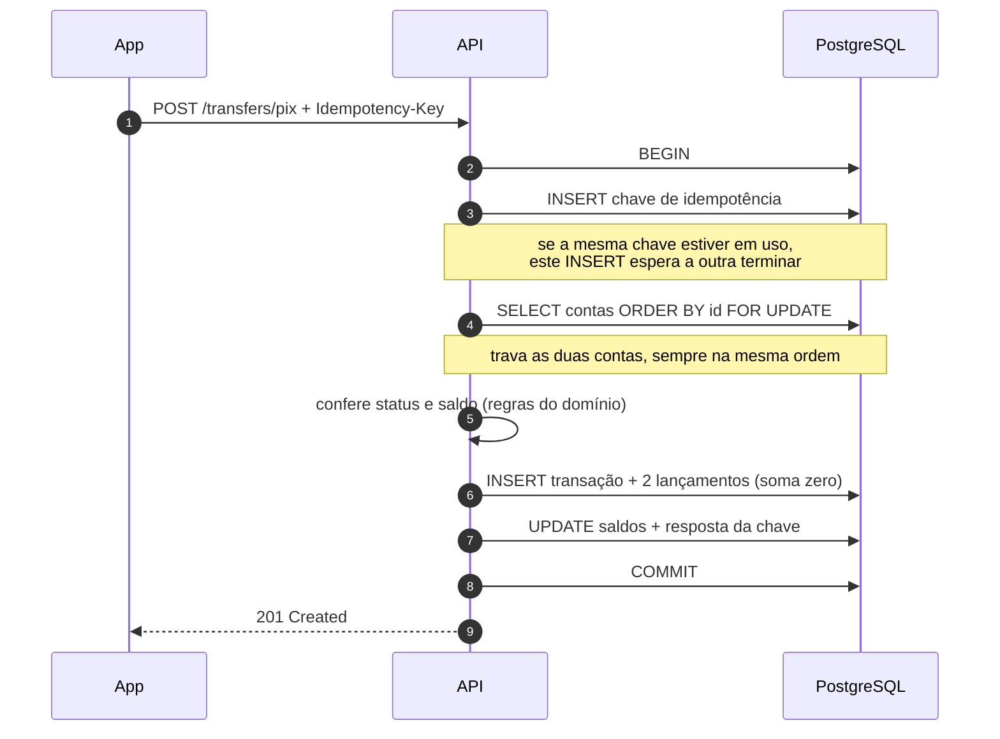
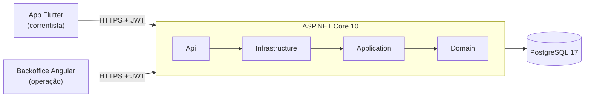

# Wallet Ledger API

[](https://github.com/Mavoxweb/wallet-ledger-api/actions/workflows/ci.yml)


API de uma **carteira digital** com **livro-razão de partidas dobradas**: contas, depósitos, transferências PIX por chave, extrato e QR code de cobrança no padrão BR Code.

O foco não é ter muitas telas nem muitos recursos. É **não errar com dinheiro**: nenhum saldo negativo quando várias transferências chegam ao mesmo tempo, nenhuma cobrança duplicada quando o cliente repete a requisição, e cada centavo com origem e destino rastreáveis.

> Faz parte do **Wallet Ledger**, um sistema com três repositórios:
> - **wallet-ledger-api**: esta API (.NET)
> - **wallet-ledger-mobile**: app do correntista em Flutter *(em construção)*
> - **wallet-ledger-backoffice**: painel da operação em Angular *(em construção)*

## Sumário

- [Destaques técnicos](#destaques-técnicos)
- [Como uma transferência funciona](#como-uma-transferência-funciona)
- [Arquitetura](#arquitetura)
- [Como rodar](#como-rodar)
- [Endpoints](#endpoints)
- [Como testar](#como-testar)
- [Limitações e próximos passos](#limitações-e-próximos-passos)
- [Sobre este projeto](#sobre-este-projeto)

---

## Destaques técnicos

| Pergunta | Resposta curta | Detalhes |
|---|---|---|
| Como evita saldo negativo com transferências simultâneas? | Transação + `SELECT … FOR UPDATE`, sempre em ordem crescente de id decidida pelo PostgreSQL, o que também evita deadlock. Há um teste com **100 PIX cruzados ao mesmo tempo** | [ADR 0004](docs/adr/0004-ordem-de-travamento.md) |
| E se o cliente repetir a requisição? | `Idempotency-Key` obrigatório, gravado **na mesma transação** dos lançamentos. A repetição recebe a mesma resposta, byte a byte, e o dinheiro sai uma vez só | [ADR 0005](docs/adr/0005-idempotencia-no-postgres.md) |
| Como garante que nenhum dinheiro some ou aparece? | Partidas dobradas: todo lançamento tem contrapartida, a soma global é sempre zero, e nada é editado, só estornado | [ADR 0003](docs/adr/0003-partidas-dobradas.md) |
| Como representa dinheiro? | Inteiro em centavos. Nenhum `double` em lugar nenhum | [ADR 0002](docs/adr/0002-dinheiro-em-centavos.md) |
| Como o código está organizado? | Clean Architecture em 4 projetos, com as regras no domínio e sem camadas desnecessárias | [ADR 0001](docs/adr/0001-clean-architecture.md) |
| Como os clientes consomem a API sem quebrar? | Contrato OpenAPI gerado do código, verificado no CI e publicado por versão | [ADR 0006](docs/adr/0006-contrato-gerado-do-codigo.md) |

Também vale olhar:
- **Refresh token com rotação e detecção de reuso**: se um token roubado for reaproveitado, todas as sessões daquele usuário caem.
- **Defesa em profundidade**: além das regras no domínio, o banco tem `CHECK` de saldo não negativo, índices únicos e chaves estrangeiras.
- **BR Code feito do zero** e validado contra o exemplo oficial do Banco Central, CRC16 incluso.
- **Testes contra PostgreSQL de verdade** (Testcontainers). As garantias que importam aqui (travas, unicidade, transações) são do banco, então testar com banco falso não provaria nada.

## Como uma transferência funciona



Se qualquer regra falhar (saldo insuficiente, conta bloqueada), o `ROLLBACK` desfaz tudo, inclusive a chave de idempotência, e o cliente pode tentar de novo.

## Arquitetura



```
src/
├── WalletLedger.Domain/          regras puras: Money, Account, LedgerTransaction, PixKey, BrCode
├── WalletLedger.Application/     casos de uso (um handler por operação) e validação
├── WalletLedger.Infrastructure/  EF Core, migrations, JWT, idempotência, travamento de contas
└── WalletLedger.Api/             controllers, filtros, erros (ProblemDetails), OpenAPI
tests/
├── WalletLedger.Domain.Tests/        testes unitários do domínio
└── WalletLedger.IntegrationTests/    API + PostgreSQL real em contêiner
contracts/openapi.json                contrato gerado a cada build
docs/adr/                             registro das decisões de arquitetura
requests.http                         roteiro de demonstração
```

## Como rodar

Pré-requisito: **Docker**.

```bash
git clone https://github.com/Mavoxweb/wallet-ledger-api.git
cd wallet-ledger-api
docker compose up --build
```

| | Endereço |
|---|---|
| API | http://localhost:8080 |
| Documentação interativa | http://localhost:8080/docs |
| Saúde | http://localhost:8080/health |

O banco é criado e migrado sozinho, já com contas de demonstração:

| E-mail | Senha | Perfil | Saldo inicial | Chave PIX |
|---|---|---|---|---|
| `ana@walletledger.dev` | `Demo@1234` | Cliente | R$ 2.500,00 | `ana@walletledger.dev` |
| `bruno@walletledger.dev` | `Demo@1234` | Cliente | R$ 2.500,00 | `bruno@walletledger.dev` |
| `operador@walletledger.dev` | `Demo@1234` | Operador | — | — |
| `admin@walletledger.dev` | `Demo@1234` | Admin | — | — |

O caminho mais rápido para ver tudo funcionando é o [`requests.http`](requests.http): login, saldo, PIX (rode duas vezes e veja o dinheiro sair uma vez só), extrato e QR code. Funciona no VS Code (extensão REST Client) e no Rider. Se preferir o Postman, importe o `contracts/openapi.json`.

## Endpoints

| Método | Rota | O que faz |
|---|---|---|
| `POST` | `/api/v1/auth/register` | Cadastra o cliente e abre a conta |
| `POST` | `/api/v1/auth/login` | Access token (15 min) + refresh token (30 dias) |
| `POST` | `/api/v1/auth/refresh` | Troca o refresh token por um novo |
| `POST` | `/api/v1/auth/logout` | Revoga o refresh token |
| `GET` | `/api/v1/me` | Perfil de quem está logado |
| `GET` | `/api/v1/account` | Saldo e status da conta |
| `GET` | `/api/v1/account/statement` | Extrato com paginação por cursor |
| `POST` | `/api/v1/deposits/simulated` | Depósito de demonstração · exige `Idempotency-Key` |
| `GET` `POST` `DELETE` | `/api/v1/pix/keys` | Chaves PIX da conta (e-mail, celular, aleatória) |
| `GET` | `/api/v1/pix/keys/lookup` | Mostra de quem é a chave (nome e CPF mascarados) |
| `POST` | `/api/v1/transfers/pix` | Transferência por chave · exige `Idempotency-Key` |
| `POST` | `/api/v1/pix/charges` | QR code de cobrança no padrão BR Code |

Valores sempre em **centavos** (`amountCents`). Erros no formato **ProblemDetails** (RFC 9457), com um `code` estável para as regras de negócio (`insufficient_funds`, `account_not_active`, `self_transfer`…), para o app decidir a mensagem sem depender do texto.

## Como testar

Pré-requisitos: **.NET 10 SDK** e **Docker em execução** (os testes de integração sobem um PostgreSQL descartável).

```bash
dotnet test
```

São **133 testes** (54 de domínio e 79 de integração). Os que eu mais gosto de mostrar:

- **100 transferências cruzadas simultâneas**: nenhum saldo negativo, nenhum deadlock, total das contas inalterado e o razão somando zero. Para ter certeza de que o teste não passa "por sorte", quebrei a ordem do travamento de propósito: ele falhou com deadlocks, como deveria.
- **Duas requisições paralelas com a mesma chave de idempotência** → exatamente uma transação.
- **Limite diário de depósito virando à meia-noite de Brasília**, com o relógio controlado no teste (nenhum código usa `DateTime.Now`).
- **Detecção de reuso de refresh token.**
- **QR code comparado com o exemplo oficial** do Manual do BR Code, caractere por caractere.

## Limitações e próximos passos

Para ser claro sobre o que este projeto **não** é:

- **O PIX é simulado.** Não há integração com o sistema do Banco Central (SPI/DICT). Um app de banco reconhece o QR code gerado, mas não consegue pagar, porque as chaves só existem aqui.
- **O depósito é de demonstração.** A ideia é que ele seja substituído por um hub de pagamentos que receba confirmações por webhook.
- **A conta de liquidação é um ponto de disputa.** Todo depósito trava essa mesma linha, então depósitos simultâneos entram em fila. Para o volume deste projeto é correto e simples; em escala real, eu dividiria em várias contas de liquidação.

O que vem a seguir:
- [ ] App Flutter do correntista (saldo, PIX, extrato, leitura de QR code, biometria)
- [ ] Backoffice Angular (busca de contas, bloqueio, estorno, trilha de auditoria)
- [ ] Limites de PIX diário e noturno, como a regra do Banco Central
- [ ] Outbox e notificações em tempo real (SignalR)
- [ ] Demo online com PostgreSQL serverless (Neon)

---

## Sobre este projeto

Passei os últimos anos integrando sistemas que mexem com dinheiro: ERP conversando com e-commerce, gateways de pagamento, conciliação de pedidos. E percebi que os bugs que mais doem raramente estão na tela. Estão no que acontece quando duas coisas chegam ao mesmo tempo, quando a internet do cliente cai no meio de um pagamento, quando alguém clica duas vezes no botão de pagar.

Construí o Wallet Ledger para colocar essas lições num lugar só, com código que eu consigo abrir e explicar linha por linha. Cada decisão importante está registrada num ADR, com as alternativas que considerei e o motivo de ter escolhido o caminho que escolhi. Algumas foram óbvias. Outras, como não usar Redis para a idempotência, vieram de pensar no que acontece quando as coisas dão errado.

Se você é recrutador ou trabalha com sistemas financeiros e quer conversar sobre alguma dessas escolhas, ou discordar de alguma delas, vou gostar muito. É assim que a gente aprende.

**Alex Marques** · Desenvolvedor Full Stack · Rio de Janeiro
[LinkedIn](https://www.linkedin.com/in/alex-marques-455089205) · [GitHub](https://github.com/Mavoxweb)
